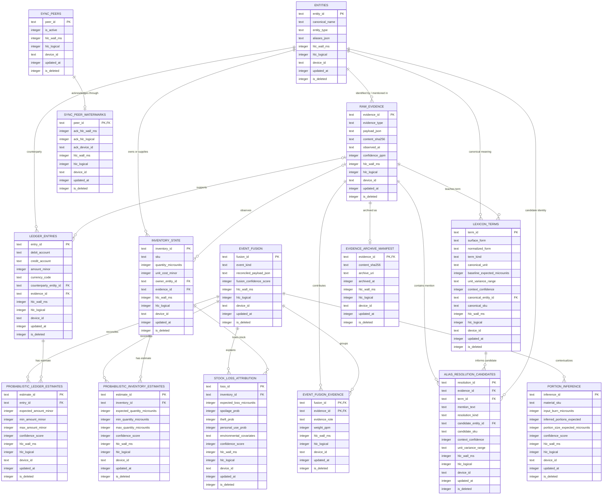

# Database Architecture Complete — Canonical Team and Agent Context

> Status: production architecture complete. `server/src/db/init_db.sql` is the canonical initializer; Phase 1–4 files are historical, modular sources and must not be re-run after it.

## Current `server/src/db/` file inventory

| File | Role | Status |
|---|---|---|
| `init_db.sql` | Canonical production initializer (all phases merged) | ✅ Active |
| `phase1_crdt_schema.sql` | Historical source — Phase 1 CRDT tables | 📦 Reference only |
| `phase2_probabilistic_schema.sql` | Historical source — Phase 2 probabilistic extension | 📦 Reference only |
| `phase3_linguistics_and_views.sql` | Historical source — Phase 3 lexicon and resolved views | 📦 Reference only |
| `phase4_optimizations.sql` | Historical source — Phase 4 edge optimizations | 📦 Reference only |
| `database.ts` | `ProbabilisticLedgerDatabase` class + `initializeDatabase()` singleton | ✅ Active |
| `dbTypes.ts` | All branded types, row interfaces, input interfaces, and validators | ✅ Active |
| `schema.ts` | Redundant stub (unused `AuditRecord`/`StateStore`) | 🗑️ Deleted |
| `storage.ts` | Redundant stub (unused `LedgerStorage` class) | 🗑️ Deleted |

> **Agent rule:** Do **not** recreate `schema.ts` or `storage.ts`. All types live in `dbTypes.ts`; the database class lives in `database.ts`.

# Core schema memory

## Design decisions

- **Canonical production initializer:** `server/src/db/init_db.sql`. Run this single script for a new database; it orders PRAGMAs, tables, CRDT views, indexes, and protective triggers.
- Canonical Phase 1 schema source: `server/src/db/phase1_crdt_schema.sql`.
- Canonical Phase 2 schema source: `server/src/db/phase2_probabilistic_schema.sql`; it extends Phase 1 without mutating factual ledger or inventory rows.
- Canonical Phase 3 schema source: `server/src/db/phase3_linguistics_and_views.sql`; it adds local-language resolution and CRDT-resolved read views.
- Canonical Phase 4 schema source: `server/src/db/phase4_optimizations.sql`; it configures edge durability, optimizes read paths, and defines sync-safe evidence archival.
- SQLite is configured by the consuming application with `foreign_keys = ON`, WAL journaling, and a busy timeout.  The schema itself is portable SQLite DDL.
- Synchronised rows carry a Hybrid Logical Clock tuple: `hlc_wall_ms`, `hlc_logical`, and `device_id`.  `updated_at` is the physical HLC millisecond value so it can be indexed and displayed without parsing a packed clock.
- `MIN_VALID_HLC_MS` is **946684800000** (2000-01-01 UTC).  A clock reset to 1970 is rejected by `CHECK` constraints before it can become a winning version.  Merge code must compare `(hlc_wall_ms, hlc_logical, device_id)` lexicographically and only apply a strictly newer tuple.
- All logical deletions are tombstones (`is_deleted`); sync must retain them until every replica has acknowledged them.  Never physically delete synced rows during normal operation.
- IDs are client-generated, opaque TEXT identifiers (UUID/ULID compatible), enabling offline insertion without a central allocator.
- Monetary amounts are signed integer minor units.  A ledger row stores exactly one debit account and one credit account; its amount must be positive.  A transfer produces an auditable double-entry pair in one immutable row.
- Evidence payloads are treated as untrusted, append-only envelopes.  Binary attachments live outside SQLite and are referenced by content hash/path metadata in `payload_json`.

## Core ER diagram



## Merge and accounting invariants

1. A version is accepted only when its `(hlc_wall_ms, hlc_logical, device_id)` is greater than the stored tuple.  SQL upserts must put this predicate in their `WHERE` clause.
2. The database only permits physical HLC values on or after 2000-01-01, non-negative logical counters, non-empty device IDs, and `updated_at = hlc_wall_ms`.
3. Posted ledger records are immutable business facts. Corrections should be compensating entries; a tombstone is reserved for synchronisation of locally created, not-yet-final evidence.
4. `inventory_state` is a materialized, mergeable observation/state record; downstream reconciliation derives changes from evidence and ledger facts rather than mutating historical facts.
5. Phase 2 stores uncertainty in extension tables.  It does not overwrite immutable Phase 1 facts: estimates retain a range, an expected value, a confidence score, source distribution JSON, and optional links to a fact or fused event.
6. `event_fusion` reconciles contradictory inputs; `event_fusion_evidence` preserves every contributing evidence row and its role/weight.  Loss attribution probabilities sum to 1,000,000 ppm.  Portion inference uses observed material burn over a time window, output ranges, and context—not a required BOM.

## Read-Path via Views

- Applications read factual state from `resolved_entities`, `resolved_ledger`, and `resolved_inventory`, rather than calculating HLC ordering in every query.
- Each view ranks versions within its logical identifier by `(hlc_wall_ms DESC, hlc_logical DESC, device_id DESC)`.  The final device identifier is a deterministic LWW tie-breaker.
- The rank is evaluated before tombstones are removed.  Therefore, a newer `is_deleted = 1` version suppresses an older live version instead of allowing it to reappear.
- `lexicon_terms` holds locally learned forms such as `mutthi`, `pao`, or `Sharma ji`; ranges and contextual ppm confidence preserve uncertainty. `alias_resolution_candidates` records evidence-linked probabilistic candidates for people and material SKUs without prematurely asserting a single identity.

## Edge optimization and archival

- Each connection enables foreign keys, WAL, a 5-second busy timeout, a 20 MiB cache, in-memory temporary tables, a bounded WAL, and `synchronous = FULL`. This privileges committed-data durability while WAL keeps readers from blocking writers.
- Composite LWW indexes use the logical ID followed by descending physical HLC, logical HLC, device tie-breaker, and deletion flag. Range indexes are confidence-first and then store lower/upper bounds; lexicon indexes support normalized local-language and alias search.
- `sync_peers` defines replicas that must acknowledge data. `sync_peer_watermarks` is a globally ordered HLC acknowledgement position per active peer.
- `prunable_raw_evidence` is deliberately conservative: it selects only live evidence represented in a live fusion, linked through that fusion to a live ledger entry, and acknowledged by every active peer.
- Pruning is archival redaction, never a physical `DELETE`: `evidence_archive_manifest` preserves the evidence ID, hash, and archive URI; a newer HLC tombstone replaces the bulky JSON payload. The resulting tombstone is synced before any future vacuum/compaction policy can reclaim storage.

## Production handoff

### Table responsibilities

| Layer | Tables | Contract |
|---|---|---|
| Factual core | `entities`, `raw_evidence`, `ledger_entries`, `inventory_state` | Identity, untrusted inputs, strict debit/credit facts, and stock snapshots. |
| Fusion and estimates | `event_fusion`, `event_fusion_evidence`, `probabilistic_*` | Retain all evidence and publish reconciled ranges without changing immutable facts. |
| Inference | `stock_loss_attribution`, `portion_inference` | Explain unrecorded loss and infer output/portion ranges without a fixed BOM. |
| Local language | `lexicon_terms`, `alias_resolution_candidates` | Resolve colloquial units and aliases with contextual probability. |
| Sync and retention | `sync_peers`, `sync_peer_watermarks`, `evidence_archive_manifest` | Prove replica acknowledgement and retain archival audit identity. |

### Write and read contracts

- Write code must generate an HLC tuple and apply a version only if `(hlc_wall_ms, hlc_logical, device_id)` is strictly greater than the stored tuple.
- `MIN_VALID_HLC_MS` is `946684800000`; this rejects reset-to-1970 clocks. Every synchronised table requires HLC fields, `updated_at = hlc_wall_ms`, and `is_deleted`.
- Use `resolved_entities`, `resolved_ledger`, and `resolved_inventory` for ordinary product reads. Views rank first and only then filter a winning tombstone, preventing deleted values from resurfacing.
- Monetary values are integer minor units, quantities are integer microunits, and probabilities/confidence values are ppm (`0..1000000`).

### Deployment and retention

- The initializer configures WAL, `synchronous=FULL`, a 20 MiB cache, a 5-second busy timeout, bounded WAL size, in-memory temp storage, and `trusted_schema=OFF`. Set `foreign_keys=ON` again for every application connection.
- LWW indexes follow logical ID plus descending HLC tuple; estimate indexes are confidence-first with min/max bounds; lexicon indexes serve normalized local-language terms and aliases.
- `prunable_raw_evidence` is eligible only when live fusion and ledger links exist and every active peer watermark acknowledges the evidence tuple. Archive by creating a manifest and applying a newer tombstone that replaces the bulky payload; never issue `DELETE` against `raw_evidence`.
- Protective triggers reject hard deletion of raw evidence and archive manifests. Sync archival tombstones before maintenance compaction.

# Backend & TypeScript Integration Blueprint

This section is the implementation contract for backend agents. Do not introduce a second schema source: `server/src/db/init_db.sql` is the sole production initializer. Do not create application tables or views with ad-hoc migration strings that duplicate its DDL.

## 1. Database initialization strategy

1. Bundle/read `server/src/db/init_db.sql` as a UTF-8 text asset at build time. Do not depend on a relative runtime filesystem path in mobile, serverless, or edge deployments. The initialization module should receive the script text (or load the bundled asset through the platform's supported asset API).
2. Open one application database connection, then execute the entire initializer in order as a script. It contains PRAGMAs, tables, views, indexes, and triggers and must not be naively split on semicolons: SQL comments, trigger bodies, and string values make that unsafe. Use the driver's script/batch API where available (for example, `better-sqlite3`'s `exec`); for Expo, use the documented async script execution/migration mechanism that preserves statement boundaries.
3. Treat initialization as idempotent schema provisioning, not as a per-request operation. Run it once when the database is opened/created and serialize concurrent startup callers behind one initialization promise/mutex. Record and check an application-owned schema version only if future migrations are added; do not claim success merely because the database file exists.
4. Run a post-initialization smoke check in the same startup flow: confirm `sqlite_master` contains the core tables and `resolved_entities`, `resolved_ledger`, and `resolved_inventory` views. Fail closed if the full initializer could not execute—never continue with a partially initialized database.
5. `foreign_keys` is connection-scoped. Enable and verify `PRAGMA foreign_keys = ON` on **every** newly opened connection, including reader, writer, worker, and sync connections. Preserve the initializer's durability settings (`journal_mode=WAL`, `synchronous=FULL`, `busy_timeout=5000`, etc.) where the driver/platform permits them. On platforms that reject a PRAGMA (notably some sandboxed/edge environments), explicitly record the capability gap and retain the remaining safe settings; do not silently substitute weaker semantics.
6. Driver split:
   - **Node/server:** use `better-sqlite3` for its synchronous, transactional `exec`, `prepare`, and `transaction` APIs. Open the database once per process/worker lifecycle and close it only during controlled shutdown.
   - **React Native/edge-local:** use Expo SQLite's promise APIs (`openDatabaseAsync`, `execAsync`/transaction APIs, prepared statements) with the schema text bundled in the app. Keep calls parameterized and await setup before exposing repositories.
   - For truly remote/serverless runtimes, use a SQLite-compatible driver only if it guarantees the required transaction, JSON1, window-function, STRICT-table (SQLite 3.37+), WAL/locking, and prepared-statement behavior. Otherwise use a compatible storage adapter rather than pretending the local schema has been initialized.
7. Never interpolate values into initializer or query SQL. Bind parameters. Execute multistep writes (including deferred foreign-key relationships, sync batch application, and archival) in a transaction; use `BEGIN IMMEDIATE` for the documented archive procedure and other read-modify-write operations that must exclude competing writers.

## 2. TypeScript type mapping (`dbTypes.ts`)

Create `dbTypes.ts` as the single database-boundary type module. It should distinguish raw SQLite rows from decoded domain values, and it must export no permissive `any` fields for schema-owned data.

- Map SQLite `TEXT` to `string`; `INTEGER` to `number`; nullable columns to `T | null`; `is_deleted` to `0 | 1` at the row boundary (with an optional decoded `boolean` domain form). Times—including `occurred_at`, `observed_at`, `updated_at`, and HLC wall time—are epoch milliseconds as `number`, not ISO strings. Keep minor currency units and microunits as integers; if amounts can exceed JavaScript's safe integer range, make the driver adapter return decimal strings/`bigint` consistently and document that conversion at this boundary.
- Define reusable branded/domain aliases so incompatible integers cannot be casually mixed: `Ppm` for the closed integer range `0..1_000_000`, `HlcWallMs` for integers `>= 946684800000`, `HlcLogical` for non-negative integers, `DeviceId`, and opaque text IDs such as `EntityId`, `EvidenceId`, `LedgerEntryId`, `InventoryId`, and `FusionId`. TypeScript cannot prove numeric ranges from an arbitrary database row, so expose parsing/constructor guards that validate `Number.isInteger` and the schema range before branding. Never use a bare `number` for a validated confidence/probability in domain models.
- Model the CRDT metadata as a shared `HlcTuple` interface with exactly `hlc_wall_ms`, `hlc_logical`, and `device_id`, then compose it into every synchronized base-table row together with `updated_at` and `is_deleted`. Provide a single comparator for lexicographic `(wall, logical, device)` ordering and require `updated_at === hlc_wall_ms` when decoding or creating a row.
- Represent enum-constrained SQL text as literal unions matching the initializer exactly: entity types, evidence types, fusion event kinds, resolution methods, inference methods, lexicon term kinds, alias resolution kinds, evidence roles, and archive reasons. Currency is an uppercase three-character string validated at construction; it is not an unconstrained `string` in write inputs.
- Keep JSON TEXT distinct from decoded JSON. For each JSON column, define (a) a raw `...Json: string` field matching SQLite and (b) a decoded, readonly domain shape validated on parsing and serialized with `JSON.stringify` only at write time. At minimum cover `aliases_json`, evidence/fusion payloads, contradiction summaries, `distribution_json`, `environmental_covariates`, `context_json`, `unit_variance_range`, and `rationale_json`. Use `unknown`/`Record<string, unknown>` for intentionally extensible payload envelopes, then refine per producer/consumer with runtime validators; do not cast parsed JSON directly to an interface.
- Map all confidence and probability fields (`confidence_ppm`, `fusion_confidence_score`, `confidence_score`, `context_confidence`, and the loss-attribution probabilities) to validated `Ppm`. For loss attribution, additionally validate the four probability fields sum to exactly `1_000_000`. Model estimate and inference ranges as readonly `{ min, expected, max }` structures with constructors enforcing `min <= expected <= max`; use equivalent range validation for lexicon baseline values when they are present.
- Create separate interfaces for each base table (`EntityRow`, `RawEvidenceRow`, `LedgerEntryRow`, `InventoryStateRow`, etc.), each read view (`ResolvedEntityRow`, `ResolvedLedgerRow`, `ResolvedInventoryRow`), and insert/upsert inputs. Read-view types must not claim columns omitted by their view. Write input types must omit database-controlled metadata except the caller-provided, validated HLC tuple and tombstone intent.

## 3. Query-layer guidelines

### Reads: always use resolved LWW views for current product state

- Use `resolved_entities`, `resolved_ledger`, and `resolved_inventory` for normal state reads, joins, filters, and UI/API responses. Do not recreate `ROW_NUMBER()` LWW logic in TypeScript or filter `is_deleted=0` on base tables before choosing a winner; doing so can resurrect an older live record after a newer tombstone.
- Parameterize every predicate and paginate with an explicit, stable sort/keyset. Read base tables only for sync replication, audit/history, diagnostic tooling, or carefully designed archive workflows. Reads of probabilistic, inference, lexicon, and sync tables must still filter/resolve tombstones according to their own query contract; no generic `WHERE is_deleted=0` rule replaces LWW resolution where historical versions can coexist.
- Decode database rows through the `dbTypes.ts` validators at the repository boundary. Treat invalid JSON, range violations, and unexpected enum values as data-integrity failures with actionable diagnostics, not values to coerce silently.

### Writes: base tables only, with validated HLC and conditional LWW application

1. Generate the HLC before creating a write. Maintain last-observed wall/logical state per device: use `max(Date.now(), last.wall)`; increment logical when the wall clock does not advance, otherwise reset logical to zero. Merge a received remote HLC into that local state before issuing subsequent local writes. Reject local/remote tuples with wall time below `946684800000`, negative logical values, or blank device IDs.
2. Set `updated_at` to exactly `hlc_wall_ms`, generate opaque client IDs locally, and use `is_deleted = 0` for live versions or `1` for tombstones. Never physically delete synchronized rows. Ledger corrections are compensating entries, not in-place factual edits.
3. Insert/update only base tables; views are read-only query surfaces. For each logical key, use a parameterized UPSERT/conditional update whose conflict `WHERE` clause accepts the candidate only when it is strictly newer than the stored tuple: higher `hlc_wall_ms`, or equal wall plus higher `hlc_logical`, or equal wall/logical plus lexicographically greater `device_id`. If the driver reports zero changed rows, treat that as an expected stale-write outcome, then read the resolved view if the caller needs the winner.
4. Wrap related records in a transaction and honor deferred foreign keys. For a sync batch, validate every decoded row first, apply in dependency-safe order (or in one deferred-FK transaction), and roll back the whole batch on constraint failure. Do not overwrite immutable ledger business facts; add a compensating fact or a newer synchronization tombstone only when the business rule permits it.
5. Archive raw evidence only through the documented `prunable_raw_evidence` eligibility check and the one-transaction manifest-plus-newer-HLC-tombstone procedure. The protective triggers intentionally reject hard deletes.

### Required backend tests

- Fresh-database initialization is repeatable and produces all tables, indexes, triggers, and resolved views.
- A newer live version wins; a newer tombstone hides an older live version; a lower/equal HLC tuple cannot overwrite the winner; equal wall/logical values use `device_id` as the deterministic tie-breaker.
- HLC generation handles repeated and backwards wall-clock readings without producing a non-monotonic local tuple.
- JSON decoding, ppm/range guards, and loss-probability-sum validation reject malformed values before writes.
- Foreign keys are enabled on each connection, all SQL is parameterized, and archival never issues `DELETE` against protected tables.

---

# Offline SLM Pipeline — API Contracts (`database.ts`)

This section documents the six methods added to `ProbabilisticLedgerDatabase` to support the 100 % offline continuous SLM pipeline.  All methods live in `server/src/db/database.ts` and are governed by the same CRDT, HLC, and double-entry invariants described above.

## Exported input types

| Type | Purpose |
|---|---|
| `VoicePayload` | Typed payload envelope stored in `raw_evidence.payload_json` for `evidence_type='voice'`. Fields: `speaker` (`'VENDOR'｜'CUST_1'｜'CUST_2'｜'SOUNDBOX_CHIME'`), `text`, `timestamp` (epoch-ms). |
| `RawEvidenceInput` | Input to `insertRawEvidence`. Accepts `evidence_type` narrowed to `'voice'｜'sensor'｜'receipt'` (the three types the pipeline produces). |
| `InventoryBatchItem` | A single morning mandi line: `sku`, `quantityKg`, `effectiveCostPerKg`, `hlc`. |
| `UpiEvent` | Classified soundbox event: `type` (`'CONFIRMED_SALE'｜'PERSONAL_TRANSFER'｜'NEIGHBOR_CHIME'`), `amount_minor?`, `reference_id?`, `memo?`, `occurred_at?`, `hlc`. |
| `EodSaleLine` | One sold line for EOD: `sku`, `quantity_microunits`, `amount_minor`. |
| `NightEodInput` | Full EOD payload: `session_date_iso`, `discovered_sales`, `drawer_expected_minor`, `drawer_counted_minor`, `hlc`. |

---

## Task 1 — Streaming Speech Transcripts

### `insertRawEvidence(input: RawEvidenceInput): boolean`

Persists a diarized speech turn or any sensor/receipt evidence envelope into `raw_evidence`.  The `payload` object is serialised to `payload_json`.  Evidence rows are append-only (schema trigger blocks hard-deletes); logical deletion requires a newer HLC tombstone with `is_deleted = 1`.

**Validations performed before the write:**
- `confidence_ppm` must be an integer in `0..1_000_000`.
- `observed_at` must be an integer epoch-ms `>= 946_684_800_000`.
- `hlc` is asserted through `assertHlcTuple`.

**Returns:** `true` on insert/LWW-update; `false` when the stored version is already strictly newer (stale write silently ignored).

---

### `getDailySpeechTranscripts(sinceTimestamp: number): Array<{ speaker: string; text: string; timestamp: number }>`

Queries `raw_evidence` for all rows with `evidence_type = 'voice'`, `is_deleted = 0`, and `observed_at >= sinceTimestamp`, ordered `ASC` by `observed_at`.  `payload_json` is parsed in-process; rows whose payload does not match the `VoicePayload` shape (`speaker: string`, `text: string`, `timestamp: number`) are silently skipped.

**Usage:** Pass a rolling start-of-day epoch-ms.  Pass `0` only for diagnostics, never in production hot-paths with large datasets.

---

## Task 2 — Morning Mandi Wholesale Basis

### `upsertInventoryBatch(items: Array<InventoryBatchItem>): boolean`

Executes an atomic batch upsert of morning mandi purchase lines.

**Unit conversions (per item):**
- `quantityKg × 1_000_000` → `quantity_microunits` (rounded integer)
- `effectiveCostPerKg × 100` → `unit_cost_minor` in paise (rounded integer)
- `(quantity_microunits / 1_000_000) × unit_cost_minor` → `total_cost_minor` for the ledger

**Inventory upsert conflict target:** `(sku, location_code, owner_entity_id)` with `owner_entity_id = NULL` (no owner column set by this method).  LWW predicate guards against overwriting a newer concurrent version.

**Double-entry per SKU** (only posted when `total_cost_minor > 0`):
```
DR  Assets:Inventory:<sku>
CR  Assets:Cash/Payables
```
Memo: `"Morning mandi — <qty> kg of <sku> @ ₹<price>/kg"`

**Transaction:** The entire batch runs in a single `better-sqlite3` transaction.  Any constraint violation rolls back all items.

**Returns:** `true` if every inventory row changed; `false` if any item was a stale write.

**Throws:** If `quantityKg <= 0` or `effectiveCostPerKg < 0` for any item.

---

## Task 3 — Dual UPI Cross-Validation Entry Routing

### `routeUpiEvent(event: UpiEvent): boolean`

Routes a classified soundbox / UPI event to the correct accounting path.

| `event.type` | Action |
|---|---|
| `CONFIRMED_SALE` | `insertLedgerEntry`: DR `Assets:Bank:UPI`  CR `Revenue:Sales` |
| `PERSONAL_TRANSFER` | `insertLedgerEntry`: DR `Assets:Bank:UPI`  CR `Equity:OwnerPersonalCapital` |
| `NEIGHBOR_CHIME` | **Zero** ledger entries. Calls `insertRawEvidence` with `evidence_type='sensor'`, `confidence_ppm=1_000_000`. Payload: `{ event_type, reference_id, occurred_at }`. |

**Key rule:** `NEIGHBOR_CHIME` events must never create ledger entries.  They are captured as sensor evidence for SLM correlation only.

**`entry_id` / `evidence_id`:** Prefers `event.reference_id` when provided (idempotent replay); falls back to `randomUUID()`.

**`occurred_at`:** Defaults to `hlc.hlc_wall_ms` when `event.occurred_at` is not supplied.

**Throws:** If `amount_minor` is absent, non-integer, or `<= 0` for `CONFIRMED_SALE` or `PERSONAL_TRANSFER`.

---

## Task 4 — Night EOD Reconciliation & Slack Attribution

### `burnInventoryStock(sku, quantityMicrounits, costMinor, hlc): boolean`

Reads the current live inventory from `resolved_inventory` for the given SKU, subtracts `quantityMicrounits`, and writes back via a conditional `UPDATE` with an LWW guard (inline parameter form used because `UPDATE` does not support `ON CONFLICT ... WHERE`).

When `costMinor > 0`, posts a COGS ledger entry:
```
DR  Expenses:COGS
CR  Assets:Inventory:<sku>
```
Memo: `"COGS burn — <qty> µ-units of <sku>"`

**Returns:** `true` if the `UPDATE` targeted an existing row; `false` if no resolved row exists for the SKU.  Negative post-burn quantities are allowed at the data layer; the business policy layer must enforce floor constraints.

**Throws:** If `quantityMicrounits` is not a positive integer.

---

### `processNightEodReconciliation(input: NightEodInput): string`

Executes all four EOD phases atomically inside a single `better-sqlite3` transaction.

**Phase 1 — Discovered cash sales** (for each `sale` where `sale.amount_minor > 0`):
```
DR  Assets:Cash:Drawer
CR  Revenue:Sales
Memo: "EOD cash sale — <sku> (<session_date_iso>)"
```

**Phase 2 — COGS burn** (for each `sale` where `sale.quantity_microunits > 0`):
Delegates to `burnInventoryStock`.  COGS value is derived as:
`cogsCostMinor = round(sale.amount_minor × (quantity_microunits / 1_000_000))`

**Phase 3 — Drawer slack attribution** (`slack = drawer_counted_minor − drawer_expected_minor`):

| Condition | Debit | Credit |
|---|---|---|
| `slack > 0` (surplus) | `Assets:Cash:Drawer` | `Revenue:RoundingGain` |
| `slack < 0` and `|slack| ≤ 100` (≤ ₹1, rounding noise) | `Expenses:CashRoundingLoss` | `Assets:Cash:Drawer` |
| `slack < 0` and `|slack| > 100` (material discrepancy) | `Expenses:TheftOrLeakage` | `Assets:Cash:Drawer` |

No slack entry is posted when `slack === 0`.

**Phase 4 — Fusion record** (`event_kind = 'stock_count'`, `resolution_method = 'rule'`, `fusion_confidence_score = 1_000_000`).  `reconciled_payload_json` encodes:
```json
{
  "session_date": "<session_date_iso>",
  "discovered_sales": [...],
  "drawer_expected_minor": <number>,
  "drawer_counted_minor": <number>,
  "slack_minor": <number>
}
```

**Returns:** The `fusion_id` (UUID string) of the created `event_fusion` row.  Store this in the calling service for traceability.

**Throws:** On any SQLite constraint violation; the entire transaction is rolled back.

---

## Integration notes for future agents

1. **No schema changes.** These methods operate solely on existing tables defined in `init_db.sql`.  Do not add columns or tables to support this pipeline.
2. **HLC discipline.** Always call `db.nextHlc()` immediately before each write inside a transaction loop (not once outside it), so each row gets a strictly monotonic HLC tuple.
3. **Idempotency.** `insertRawEvidence` and `insertLedgerEntry` are idempotent when the caller supplies a stable `evidence_id` / `entry_id` (e.g. a UPI reference number).  Re-running with the same ID and an equal-or-older HLC is a safe no-op.
4. **Ledger immutability.** Ledger entries are business facts.  Corrections must be compensating entries; never mutate a posted `entry_id` with a newer HLC unless it is a sync tombstone for a locally-created draft entry.
5. **Read path.** Always read inventory via `resolved_inventory` (the CRDT LWW view), never from `inventory_state` directly, to avoid resurrecting stale versions.
6. **Zero-cost items.** Both `upsertInventoryBatch` and `burnInventoryStock` skip the ledger entry when `total_cost_minor = 0` or `costMinor = 0` to satisfy the schema `CHECK(amount_minor > 0)`.
