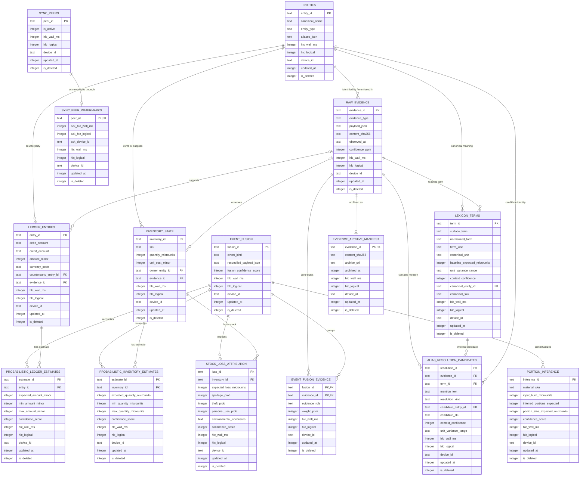

# Database Architecture Complete — Canonical Team and Agent Context

> Status: production architecture complete. `server/src/db/init_db.sql` is the canonical initializer; Phase 1–4 files are historical, modular sources and must not be re-run after it.

# Core schema memory

## Design decisions

- **Canonical production initializer:** `server/src/db/init_db.sql`. Run this single script for a new database; it orders PRAGMAs, tables, CRDT views, indexes, and protective triggers.
- Canonical Phase 1 schema source: `server/src/db/phase1_crdt_schema.sql`.
- Canonical Phase 2 schema source: `server/src/db/phase2_probabilistic_schema.sql`; it extends Phase 1 without mutating factual ledger or inventory rows.
- Canonical Phase 3 schema source: `server/src/db/phase3_linguistics_and_views.sql`; it adds local-language resolution and CRDT-resolved read views.
- Canonical Phase 4 schema source: `server/src/db/phase4_optimizations.sql`; it configures edge durability, optimizes read paths, and defines sync-safe evidence archival.
- SQLite is configured by the consuming application with `foreign_keys = ON`, WAL journaling, and a busy timeout.  The schema itself is portable SQLite DDL.
- Synchronised rows carry a Hybrid Logical Clock tuple: `hlc_wall_ms`, `hlc_logical`, and `device_id`.  `updated_at` is the physical HLC millisecond value so it can be indexed and displayed without parsing a packed clock.
- `MIN_VALID_HLC_MS` is **946684800000** (2000-01-01 UTC).  A clock reset to 1970 is rejected by `CHECK` constraints before it can become a winning version.  Merge code must compare `(hlc_wall_ms, hlc_logical, device_id)` lexicographically and only apply a strictly newer tuple.
- All logical deletions are tombstones (`is_deleted`); sync must retain them until every replica has acknowledged them.  Never physically delete synced rows during normal operation.
- IDs are client-generated, opaque TEXT identifiers (UUID/ULID compatible), enabling offline insertion without a central allocator.
- Monetary amounts are signed integer minor units.  A ledger row stores exactly one debit account and one credit account; its amount must be positive.  A transfer produces an auditable double-entry pair in one immutable row.
- Evidence payloads are treated as untrusted, append-only envelopes.  Binary attachments live outside SQLite and are referenced by content hash/path metadata in `payload_json`.

## Core ER diagram

## Merge and accounting invariants

1. A version is accepted only when its `(hlc_wall_ms, hlc_logical, device_id)` is greater than the stored tuple.  SQL upserts must put this predicate in their `WHERE` clause.
2. The database only permits physical HLC values on or after 2000-01-01, non-negative logical counters, non-empty device IDs, and `updated_at = hlc_wall_ms`.
3. Posted ledger records are immutable business facts. Corrections should be compensating entries; a tombstone is reserved for synchronisation of locally created, not-yet-final evidence.
4. `inventory_state` is a materialized, mergeable observation/state record; downstream reconciliation derives changes from evidence and ledger facts rather than mutating historical facts.
5. Phase 2 stores uncertainty in extension tables.  It does not overwrite immutable Phase 1 facts: estimates retain a range, an expected value, a confidence score, source distribution JSON, and optional links to a fact or fused event.
6. `event_fusion` reconciles contradictory inputs; `event_fusion_evidence` preserves every contributing evidence row and its role/weight.  Loss attribution probabilities sum to 1,000,000 ppm.  Portion inference uses observed material burn over a time window, output ranges, and context—not a required BOM.

## Read-Path via Views

- Applications read factual state from `resolved_entities`, `resolved_ledger`, and `resolved_inventory`, rather than calculating HLC ordering in every query.
- Each view ranks versions within its logical identifier by `(hlc_wall_ms DESC, hlc_logical DESC, device_id DESC)`.  The final device identifier is a deterministic LWW tie-breaker.
- The rank is evaluated before tombstones are removed.  Therefore, a newer `is_deleted = 1` version suppresses an older live version instead of allowing it to reappear.
- `lexicon_terms` holds locally learned forms such as `mutthi`, `pao`, or `Sharma ji`; ranges and contextual ppm confidence preserve uncertainty. `alias_resolution_candidates` records evidence-linked probabilistic candidates for people and material SKUs without prematurely asserting a single identity.

## Edge optimization and archival

- Each connection enables foreign keys, WAL, a 5-second busy timeout, a 20 MiB cache, in-memory temporary tables, a bounded WAL, and `synchronous = FULL`. This privileges committed-data durability while WAL keeps readers from blocking writers.
- Composite LWW indexes use the logical ID followed by descending physical HLC, logical HLC, device tie-breaker, and deletion flag. Range indexes are confidence-first and then store lower/upper bounds; lexicon indexes support normalized local-language and alias search.
- `sync_peers` defines replicas that must acknowledge data. `sync_peer_watermarks` is a globally ordered HLC acknowledgement position per active peer.
- `prunable_raw_evidence` is deliberately conservative: it selects only live evidence represented in a live fusion, linked through that fusion to a live ledger entry, and acknowledged by every active peer.
- Pruning is archival redaction, never a physical `DELETE`: `evidence_archive_manifest` preserves the evidence ID, hash, and archive URI; a newer HLC tombstone replaces the bulky JSON payload. The resulting tombstone is synced before any future vacuum/compaction policy can reclaim storage.

## Production handoff

### Table responsibilities

| Layer | Tables | Contract |
|---|---|---|
| Factual core | `entities`, `raw_evidence`, `ledger_entries`, `inventory_state` | Identity, untrusted inputs, strict debit/credit facts, and stock snapshots. |
| Fusion and estimates | `event_fusion`, `event_fusion_evidence`, `probabilistic_*` | Retain all evidence and publish reconciled ranges without changing immutable facts. |
| Inference | `stock_loss_attribution`, `portion_inference` | Explain unrecorded loss and infer output/portion ranges without a fixed BOM. |
| Local language | `lexicon_terms`, `alias_resolution_candidates` | Resolve colloquial units and aliases with contextual probability. |
| Sync and retention | `sync_peers`, `sync_peer_watermarks`, `evidence_archive_manifest` | Prove replica acknowledgement and retain archival audit identity. |

### Write and read contracts

- Write code must generate an HLC tuple and apply a version only if `(hlc_wall_ms, hlc_logical, device_id)` is strictly greater than the stored tuple.
- `MIN_VALID_HLC_MS` is `946684800000`; this rejects reset-to-1970 clocks. Every synchronised table requires HLC fields, `updated_at = hlc_wall_ms`, and `is_deleted`.
- Use `resolved_entities`, `resolved_ledger`, and `resolved_inventory` for ordinary product reads. Views rank first and only then filter a winning tombstone, preventing deleted values from resurfacing.
- Monetary values are integer minor units, quantities are integer microunits, and probabilities/confidence values are ppm (`0..1000000`).

### Deployment and retention

- The initializer configures WAL, `synchronous=FULL`, a 20 MiB cache, a 5-second busy timeout, bounded WAL size, in-memory temp storage, and `trusted_schema=OFF`. Set `foreign_keys=ON` again for every application connection.
- LWW indexes follow logical ID plus descending HLC tuple; estimate indexes are confidence-first with min/max bounds; lexicon indexes serve normalized local-language terms and aliases.
- `prunable_raw_evidence` is eligible only when live fusion and ledger links exist and every active peer watermark acknowledges the evidence tuple. Archive by creating a manifest and applying a newer tombstone that replaces the bulky payload; never issue `DELETE` against `raw_evidence`.
- Protective triggers reject hard deletion of raw evidence and archive manifests. Sync archival tombstones before maintenance compaction.
