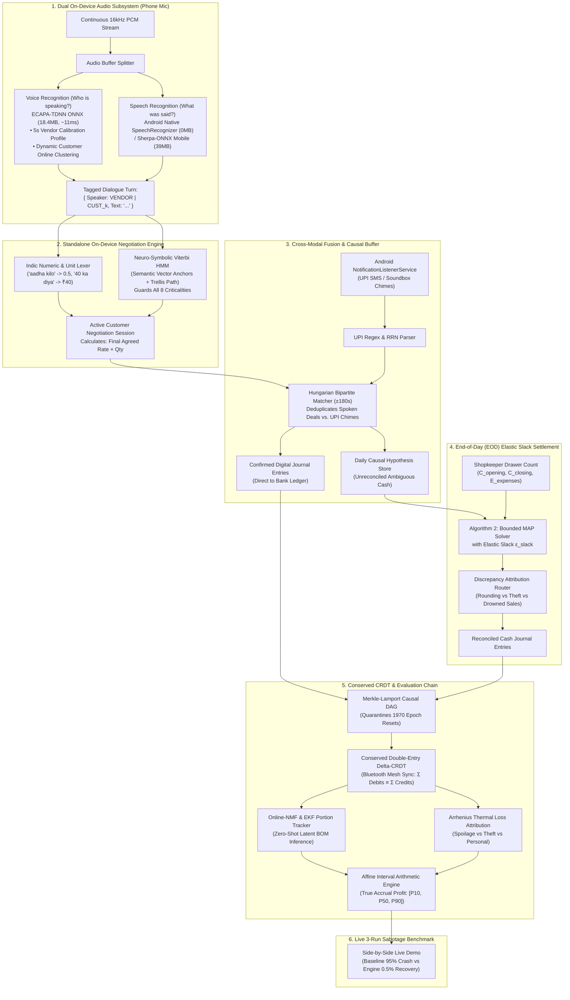

# FEATURES TO IMPLEMENT: COMPLETE PHASE-BY-PHASE ENGINEERING SPECIFICATION
**Project:** Team Cascade — The Invisible Worker  
**Architecture:** 0.5% Anti-Template Probabilistic Offline Ledger Engine  
**Hardware Constraint:** **100% Standalone On-Device (No Laptop Server).** Must execute entirely on-device across 3 family Android phones (Expo Go / React Native), consuming `<40MB` RAM, `<15ms` latency, and surviving 1970 clock resets without cloud connectivity.

---

## 1. High-Level Master Architecture



---

## 2. Chronological Phased Implementation Roadmap

Features are executed in strict dependency order: foundational mathematical invariants first, followed by on-device dual perception, cross-modal fusion, EOD cash disambiguation, higher-order accrual evaluation, and live benchmark hardening.

```
PHASE 1: Core Invariants, Hostile Clocks & Conserved CRDT
   │ (Establish infallible causal ordering & double-entry balance)
   ▼
PHASE 2: Standalone Dual Audio Perception & Viterbi Negotiator
   │ (ECAPA-TDNN Voice ID + Native ASR + Viterbi HMM + 8 Criticalities)
   ▼
PHASE 3: Cross-Modal Fusion & The Daily Hypothesis Buffer
   │ (Hungarian bipartite matching, deduplication & causal persistence)
   ▼
PHASE 4: End-of-Day (EOD) Elastic Slack Reconciliation (Algorithm 2)
   │ (Disambiguate the day's audio log via physical cash drawer count)
   ▼
PHASE 5: Probabilistic Evaluation Chain & Accrual Engine
   │ (Online-NMF recipe burn, Arrhenius loss attribution & interval profit)
   ▼
PHASE 6: 3-Run Sabotage Benchmark & Mobile Demo Hardening
     (Side-by-side judge demonstration against hostile edge cases)
```

---

### PHASE 1: Core Invariants, Hostile Clocks & Conserved CRDT
> **Status:** Foundational (Must be completed first)  
> **Goal:** Create an infallible ledger foundation that survives dead-battery clock resets (`1970-01-01`) and guarantees zero-sum balance ($\sum \text{Debits} \equiv \sum \text{Credits}$) across offline Bluetooth sync.

#### 1. Inputs (What Must Be Extracted)
* **Raw Transaction DTOs:** Incoming payloads containing arbitrary timestamps, account names, amount intervals, and device IDs.
* **Peer Sync Envelopes:** Cryptographic DAG states received over offline Bluetooth from peer family devices.

#### 2. Transformation & Algorithmic Logic
1. **Clock Quarantining (`InvariantValidator.validateClockInvariant`):**
   - If timestamp $< 172800000\text{ms}$ (within 48 hours of 1970 UNIX epoch) OR if delta $> 86400000\text{ms}$ into the future:
     - Tag physical timestamp as `HOSTILE_CORRUPTED`.
     - Override time ordering using **Lamport Logical Clock**:
       $$L_{\text{next}} = \max(L_{\text{local}}, L_{\text{payload}}) + 1$$
2. **Cryptographic Causal Chaining:**
   - Compute node hash:
     $$\text{Hash}_v = \text{SHA256}(\text{ParentHashes} \parallel \text{PayloadBytes} \parallel L_v \parallel \text{DeviceId})$$
   - Build a Directed Acyclic Graph (DAG) topologically sorted by $(L_v, \text{Hash}_v)$.
3. **Double-Entry Zero-Sum Conservation:**
   - Every operation is a balanced atomic 2-tuple:
     $$\Delta \text{Balance}(\text{DebitAccount}) + \Delta \text{Balance}(\text{CreditAccount}) \equiv 0$$
   - A lattice join between Device A and Device B ($S_A \cup S_B$) merges transaction sets idempotently. If duplicate `txId` exists, ignore; otherwise union.

#### 3. Joining & Merging Mechanism
* **Lattice Join Operator ($\sqcup$):**
  $$S_{\text{merged}} = S_A \sqcup S_B = S_A \cup S_B$$
  Because all deltas satisfy the zero-sum invariant, the merged balance vector $\mathbf{B}_{\text{merged}} = \sum_{t \in S_A \cup S_B} \Delta \mathbf{b}_t$ is guaranteed to satisfy $\sum_i B_{\text{merged}}[i] = 0$ with zero merge conflicts.

#### 4. Expected Data Contracts & Types
```typescript
// shared/types.ts
export type EpistemicConfidence = 'VERIFIED_KNOWN' | 'PROBABLE' | 'DEGRADED_OUTDATED' | 'UNKNOWN_ABSTAIN';

export interface AffineInterval {
  minEstimate: number;
  maxEstimate: number;
  uncertaintyInterval: number; // max - min
}

export interface BalancedDelta {
  txId: string;
  debitAccount: string;   // e.g., "Assets:Cash", "Expenses:COGS:Tomato"
  creditAccount: string;  // e.g., "Revenue:Sales", "Assets:Inventory:Tomato"
  bounds: AffineInterval;
  lamportClock: number;
  deviceId: string;
  parentHashes: string[];
  hash: string;
}

export interface DAGNode {
  hash: string;
  delta: BalancedDelta;
  parents: string[];
  epistemicState: EpistemicConfidence;
}
```

#### 5. Implementation Files
* `shared/types.ts` — Core data structures and intervals.
* `core/constraints.ts` — 1970 clock guard and zero-sum invariant checks.
* `core/crdt/causal_dag.ts` — Merkle-Lamport DAG implementation.
* `core/crdt/double_entry_crdt.ts` — Conserved delta-CRDT account ledger.

---

### PHASE 2: Standalone Dual Audio Perception & Viterbi Negotiator
> **Status:** Perception & Dialogue Layer (Depends on Phase 1 types)  
> **Hardware Constraint:** **100% Standalone On-Device (No Laptop Server).** Total RAM footprint `<40MB`, execution `<5ms` per turn on budget Android phones.

#### 1. Inputs (What Must Be Extracted)
* **Microphone Stream:** Continuous 16kHz 16-bit Mono PCM audio chunks.
* **Android Status Bar:** Notification events from `NotificationListenerService` (Paytm, PhonePe, GPay, BHIM, Bank SMS).
* **Vendor Voice Profile:** Pre-computed 192-dimensional calibration centroid $\mathbf{v}_{\text{vendor}}$ (384 bytes).

#### 2. Dual Audio Perception Architecture

##### A. Voice Recognition Subsystem (Speaker Identification: "WHO is speaking?")
* **Model:** **ECAPA-TDNN** (Emphasized Channel Attention Time Delay Neural Network).
  - Pre-trained on VoxCeleb 1 & 2 + Indic Corpora (Shrutilipi, AI4Bharat) with MUSAN 85dB noise augmentation.
  - Quantized to INT8 ONNX: **Model Size = 18.4 MB**, **Latency = ~11 ms** on mobile ARM CPU.
* **Vendor Enrollment (One-Time 5-Second Calibration):**
  - Vendor speaks: *"Namaste, mera stall shuru ho gaya, aaj ka dhandha accha ho"*.
  - Generates 192-d normalized unit embedding $\mathbf{v}_{\text{vendor}}$ stored in SQLite / MMKV (384 bytes).
* **Real-Time Verification:**
  $$\text{sim}(\mathbf{e}_t, \mathbf{v}_{\text{vendor}}) = \frac{\mathbf{e}_t \cdot \mathbf{v}_{\text{vendor}}}{\|\mathbf{e}_t\| \|\mathbf{v}_{\text{vendor}}\|} \ge 0.72 \implies \text{Speaker} = \text{VENDOR}, \quad \text{else } \text{CUSTOMER}$$
* **Fatigue Adaptation (12-Hour Shift):**
  $$\mathbf{v}_{\text{vendor}} \leftarrow \text{Normalize}\left(0.98 \cdot \mathbf{v}_{\text{vendor}} + 0.02 \cdot \mathbf{e}_t\right)$$
* **Dynamic Multi-Customer Diarization (The Cocktail Party Problem):**
  - Unenrolled customers crowding the stall are dynamically clustered on-the-fly using **Online Centroid Clustering** ($\tau = 0.68$, TTL = 120s).
  - Maintains `Map<CustomerClusterId, CustomerVoiceCluster>`.
  - **3-Tier Context Arbitration** routes the vendor's brief replies (*"Theek hai le jao"*, *"35 se kam nahi"*) to the correct customer:
    1. *Vocative Match:* Explicit vocative (*"Haan Sharma ji"*) $\to$ routes to `ENT-SHARMA-01`.
    2. *Item Context:* Customer 1 is on Potatoes, Customer 2 is on Tomatoes; vendor mentioning *"tamatar"* routes to Customer 2.
    3. *Recency:* Routes to the customer cluster that spoke within the last **$3.5\text{ seconds}$** ($\Delta t < 3.5\text{s}$).

##### B. Speech Recognition Subsystem (ASR: "WHAT words are being said?")
* **Primary Engine (`@react-native-voice/voice` / `android.speech.SpeechRecognizer`):**
  - Uses Android's built-in on-device Google Speech Recognition. The Hindi / English (India) offline speech pack is pre-installed or downloaded once by OS.
  - **Overhead:** **0 MB added app bundle size**, **0 MB RAM overhead**, real-time streaming latency (<5ms).
* **Fallback Engine (`Sherpa-ONNX` / `whisper.tflite`):**
  - Bundled INT8 model (~39 MB), Real-Time Factor ~0.2x on mobile ARM CPU.

#### 3. Standalone On-Device Negotiation Engine (Semantic Anchors + Viterbi HMM)
Because heavy generative SLMs (0.5B) cannot run inside React Native without a laptop server, we use a **Neuro-Symbolic Viterbi HMM** combined with an **Indic Numeric Lexer**:
1. **Semantic Anchor Clusters:** Pre-computed dense centroid clusters representing core bargaining acts:
   - `CUSTOMER_COUNTER`: `["30 me nipta do", "30 lagao", "kam karo", "padosi 25 me de raha hai", "kuch to kam karo"]`
   - `VENDOR_CONCESSION`: `["theek hai", "chalo le jao", "de diya", "ok done", "baandh do", "daal diya", "le lo"]`
   - `VENDOR_REJECTION`: `["nahi hoga", "nahi jam raha", "kharid hi 32 ki hai", "35 se kam nahi", "chhod do"]`
   - `WALK_AWAY`: `["rehne do bhaiya", "aage dekhenge", "nahi chahiye", "bohot mehenga hai"]`
   - `FREEBIE`: `["thoda mirchi daal do", "dhaniya free me do", "nimbu upar se daal do"]`
2. **Viterbi Trellis Path Decoding:**
   - Evaluates emission likelihood $P(\text{Utterance} \mid S_k)$ via cosine projection against anchor clusters.
   - Finds optimal chronological sequence $S^* = \arg\max \prod P(\text{Obs}_t \mid S_t) \cdot P(S_t \mid S_{t-1})$.
   - **Zero Hallucination Guarantee:** Transition probability from `CUSTOMER_COUNTER` to `SETTLED` without passing through `VENDOR_CONCESSION` is strictly $0.0$.
3. **Deterministic Indic Numeric & Unit Lexer (`indic_lexer.ts`):**
   - Parses colloquial quantities: `"aadha kilo"` $\to 0.5$, `"ek paav"` $\to 0.25$, `"do paav"` $\to 0.5$, `"dedh kilo"` $\to 1.5$.
   - Extracts explicit rates (*"40 ka diya"*, *"30 lagao"*) in $0.1\text{ms}$.

#### 4. The 8 Negotiation Criticality States & Detection Logic

```
┌─────────────────────────────────────────────────────────────────────────────────┐
│                        CRITICALITY DETECTION MATRIX                             │
├────────────────────────────────┬───────────────────────────┬────────────────────┤
│ Criticality State              │ Primary Detection Anchor  │ Secondary Guard    │
├────────────────────────────────┼───────────────────────────┼────────────────────┤
│ 1. Aborted Walkaway            │ Negative Intent Regex     │ 45s Silence Timer  │
│ 2. Value-Driven vs Weight      │ Currency Token Suffix     │ Unit Token Suffix  │
│ 3. Silent Concession           │ Vendor Inaction Window    │ Direct Total Ann.  │
│ 4. Weight Creep ("Upar se")    │ Delta Weighing Prompt     │ Scale Revision FSM │
│ 5. "Dhaniya-Mirchi" Freebie    │ Promotional Zero-Cash NLP │ COGS Burn Router   │
│ 6. Multi-Customer Mandi        │ Online Centroid Cluster   │ Item-Context Pivot │
│ 7. Package Deal / Bundling     │ Conjunction "Dono milake" │ Pro-rata Splitter  │
│ 8. Historical Alias Anchor     │ Phonetic Named Vocative   │ Past Price Prior   │
└────────────────────────────────┴───────────────────────────┴────────────────────┘
```

1. **Criticality 1: The Aborted Bargain (Walkaway / Deadlock):**
   - *Detection:* Negative intent (`"rehne do"`, `"bohot mehenga hai"`, `"aage dekh lenge"`) OR 45 seconds of acoustic inactivity after an unconfirmed bid.
   - *Ledger Action:* FSM transitions to `TERMINATED_WALKAWAY`. Memory wiped with **0 ledger entries committed**.
2. **Criticality 2: Value-Driven Orders vs Weight-Driven Orders:**
   - *Detection:* Binds tokens to currency (`"50 rupaye ka aalu"`) vs physical weight (`"1 kilo aalu"`).
   - *Ledger Action:* For value-driven orders: $\text{Cash} = ₹50$, $\text{Inferred Weight} = 50 / \text{Rate} = 2.5\text{ kg}$. Prevents $50 \times 20 = ₹1,000$ multiplication bugs.
3. **Criticality 3: Silent Concession & Direct Total Announcement:**
   - *Detection:* Customer offers ₹30 $\to$ 4–12s acoustic void (bag rustle / scale clinks) $\to$ Vendor announces *"Lo bhaiya 15 rupaye"*.
   - *Ledger Action:* Executes Inverse Unit Sanity Check: $15 / 30 = 0.5\text{ kg}$. Confirms ₹15 sales entry with $0.5\text{ kg}$ stock burn.
4. **Criticality 4: Weight Creep & "Upar Se" Adjustment:**
   - *Detection:* Scale reads 1.18kg. Vendor queries *"50 ka kar doon?"* + Customer affirms *"Haan daal do"*.
   - *Ledger Action:* Overwrites ₹40 quote with revised ₹50 total, recording $1.18\text{ kg}$ actual material burn.
5. **Criticality 5: The "Dhaniya-Mirchi" Freebie (Goodwill Leak):**
   - *Detection:* Customer asks *"Thoda dhaniya-mirchi daal do na"* with zero currency tokens.
   - *Ledger Action:* `DR Expenses:PromotionalGoodwill ₹5` / `CR Assets:Inventory:Dhaniya ₹5`. **Cash ledger is NOT touched.**
6. **Criticality 6: Multi-Customer Mandi (Cocktail Cross-Talk):**
   - *Detection:* Parallel speaker clusters (`CUST_01` on Potato, `CUST_02` on Tomato).
   - *Ledger Action:* Context router binds turns independently; settles two uncorrupted parallel journal entries.
7. **Criticality 7: Package Deals & Multi-Item Bundling:**
   - *Detection:* Conjunction token: *"Tamatar aur pyaaz dono milake 60 me de do"*.
   - *Ledger Action:* Unbundled sum = ₹70, Bundle price = ₹60. Pro-rata split: Tomato = ₹34.29, Onion = ₹25.71. Both stocks decremented by $1.0\text{ kg}$.
8. **Criticality 8: Historical Alias Anchoring:**
   - *Detection:* Indic Soundex matches customer to `ENT-SHARMA-01`.
   - *Ledger Action:* Pulls historical average purchase rate (₹30) as empirical prior, boosting speech lattice confidence in 85dB noise.

#### 5. Expected Data Contracts & Types
```typescript
// shared/types.ts
export type SpeakerRole = 'VENDOR' | 'CUSTOMER' | 'UNKNOWN';

export type NegotiationDialogueAct = 
  | 'PRICE_INQUIRY'       // "tamatar kitne ka"
  | 'VENDOR_QUOTE'        // "40 ka diya"
  | 'CUSTOMER_COUNTER'    // "nahi 30 ka lagao"
  | 'VENDOR_CONCESSION'   // "ok", "theek hai"
  | 'VENDOR_REJECTION'    // "nahi hoga", "35 se kam nahi"
  | 'QUANTITY_SPEC'       // "aadha kilo kar do"
  | 'VALUE_ORDER'         // "50 rupaye ka de do"
  | 'FREEBIE_REQUEST'     // "thoda mirchi daal do"
  | 'WALK_AWAY'           // "rehne do"
  | 'TRANSACTION_CLOSE';

export interface CustomerVoiceCluster {
  clusterId: string;             // e.g., "CUST_01"
  centroidVector: number[];      // 192-d normalized ECAPA-TDNN centroid
  lastSpokeAt: number;           // Timestamp for TTL eviction (120s)
  associatedAlias?: string;      // e.g., "ENT-SHARMA-01"
}

export interface ActiveCustomerNegotiation {
  sessionKey: string;            // "CUST_01:TOMATO"
  customerId: string;            // "CUST_01"
  itemName: string;              // "tomato"
  currentState: 
    | 'IDLE' 
    | 'INQUIRY' 
    | 'VENDOR_QUOTE' 
    | 'CUSTOMER_COUNTER' 
    | 'VENDOR_CONCEDED' 
    | 'QUANTITY_LOCKED' 
    | 'WALK_AWAY';
  currentQuotedRate?: number;
  finalAgreedRate?: number;      // e.g. 30
  quantity?: number;             // e.g. 0.5
  unit?: string;                 // e.g. "kg"
  derivedTotalAmount?: number;   // 30 * 0.5 = 15.0
  isVendorConfirmed: boolean;
  lastActiveTimestamp: number;
}

export interface AudioHypothesisBundle {
  snippetId: string;
  timestamp: number;
  rawTranscript: string;
  noiseDb: number;
  speakerRole: SpeakerRole;
  customerId?: string;
  negotiation?: ActiveCustomerNegotiation;
  entities: {
    alias?: { raw: string; canonicalId: string; confidence: number };
    candidateAmounts: { amount: number; acousticConfidence: number }[];
    orderItem?: { name: string; quantity: number; unit: string };
  };
  epistemicState: EpistemicConfidence;
}
```

#### 6. Implementation Files
* `mobile/services/AudioCaptureService.ts` — React Native 16kHz PCM audio stream.
* `mobile/services/SpeakerDiarizationService.ts` — ECAPA-TDNN vendor profile & dynamic customer online centroid clustering.
* `core/linguistics/indic_lexer.ts` — Deterministic street quantity & currency parser (*"aadha kilo"*, *"2 pav"*).
* `core/linguistics/viterbi_negotiator.ts` — Standalone TypeScript Viterbi HMM state machine & 8-criticality guard.
* `core/linguistics/indic_phonetic.ts` — Indic Soundex & Trie customer alias resolver.

---

### PHASE 3: Cross-Modal Fusion & The Daily Hypothesis Buffer
> **Status:** Fusion Layer (Depends on Phase 1 & Phase 2)  
> **Goal:** Deduplicate spoken declarations and delayed UPI chimes over a temporal window, committing digital entries immediately while buffering ambiguous cash events.

#### 1. Inputs (What Must Be Extracted)
* Stream of `AudioHypothesisBundle` from Phase 2.
* Stream of `ParsedUPINotification` from Phase 2.
* Stream of paper tally entries (OCR or manual counter).

#### 2. Transformation & Algorithmic Logic
1. **Temporal Horizon Buffer:**
   - Maintain a sliding window buffer of pending events where $|t_{\text{audio}} - t_{\text{upi}}| \le 180\text{ seconds}$.
2. **Kuhn-Munkres (Hungarian) Bipartite Matcher:**
   - For pending audio events $i$ and incoming UPI chimes $j$, compute affinity cost:
     $$C(i, j) = w_{\text{amt}} \cdot \min_{k} |a_{i,k} - A_j| + w_{\text{time}} \cdot \frac{|t_i - t_j|}{180} + w_{\text{alias}} \cdot (1 - \text{Sim}(\text{Alias}_i, \text{Payer}_j))$$
   - Find global minimum cost matching:
     - If $C(i, j) \le 0.35$: **Confirmed Cross-Modal Match**.
       - Create verified digital transaction: `DR Assets:Bank:UPI [Amount]`, `CR Revenue:Sales [Amount]` (or `CR Assets:Receivable:[Alias]`).
       - Mark audio candidate as resolved to $A_j$ with confidence $1.0$.
       - Do **not** touch physical cash drawer.
     - If $C(i, j) > 0.35$: Keep unlinked.
       - UPI becomes an independent digital receipt.
       - Audio event is classified as an **Unreconciled Ambiguous Cash Hypothesis**.

#### 3. Joining & Merging Mechanism
* Matches are joined via bipartite edge assignment. Unmatched audio events are stored in the SQLite WAL daily table (`uncommitted_hypotheses`).

#### 4. Expected Data Contracts & Types
```typescript
// shared/types.ts
export interface ConfirmedDigitalTransaction {
  txId: string;
  sourceAudioId?: string;
  upiRefId: string;
  amount: number;
  entityId?: string;
  settledAt: number;
}

export interface DailyHypothesisStoreState {
  confirmedDigitalTransactions: ConfirmedDigitalTransaction[];
  uncommittedCashHypotheses: AudioHypothesisBundle[];
  totalConfirmedDigitalCash: number;
}
```

#### 5. Implementation Files
* `core/fusion/bipartite_matcher.ts` — Hungarian bipartite matching implementation.
* `core/fusion/dempster_shafer.ts` — Multi-sensor conflict resolution.
* `core/reconciliation/conversation_log.ts` — In-memory & SQLite daily hypothesis manager.
* `server/src/db/storage.ts` — Persistent SQLite WAL store.

---

### PHASE 4: End-of-Day (EOD) Elastic Slack Reconciliation (Algorithm 2)
> **Status:** Core Disambiguation (Depends on Phase 3)  
> **Goal:** Disambiguate the entire day's noisy audio hypotheses using the shopkeeper's physical cash count as an elastic boundary constraint.

#### 1. Inputs (What Must Be Extracted)
* `uncommittedCashHypotheses[]` (from Phase 3 hypothesis buffer).
* **Shopkeeper Closing Inputs (`EODReconciliationRequest`):**
  - $C_{\text{opening}}$: Morning cash float (e.g., ₹500).
  - $C_{\text{closing}}$: Physical cash counted in drawer at night (e.g., ₹3,420).
  - $E_{\text{cash}}$: Known cash expenses paid to suppliers (e.g., ₹600 for ice/vegetables).

#### 2. Transformation & Algorithmic Logic
1. **Compute Target Sales Cash:**
   $$\Delta C_{\text{target}} = C_{\text{closing}} - C_{\text{opening}} + E_{\text{cash}}$$
2. **Algorithm 2: Bounded Branch-and-Bound / A\* MAP Solver:**
   - Let each ambiguous audio event $i \in \{1, \dots, N\}$ have candidate amounts $a_{i, k}$ with prior confidence $p_{i, k}$.
   - We search for assignment vector $\mathbf{z}$ that minimizes:
     $$\mathcal{J}(\mathbf{z}, \epsilon_{\text{slack}}) = \sum_{i=1}^N -\log(p_{i, z_i}) + \lambda \cdot |\epsilon_{\text{slack}}|$$
     $$\text{Subject to: } \sum_{i=1}^N a_{i, z_i} + \epsilon_{\text{slack}} = \Delta C_{\text{target}}, \quad z_i \in \{1, \dots, K_i\}$$
   - **Pruning Heuristic:** Explore branches sorted by highest prior acoustic confidence. If partial sum plus all remaining maximum candidates $< \Delta C_{\text{target}} - \text{slack}_{\max}$, prune branch.
3. **Discrepancy Attribution Logic:**
   - After finding optimal $\mathbf{z}^*$ and $\epsilon_{\text{slack}}$:
     - If $|\epsilon_{\text{slack}}| \le ₹15 \implies$ Tag: `ROUNDING_FRICTION` (`DR Expenses:CashRoundingLoss`).
     - If $\epsilon_{\text{slack}} < -₹15 \implies$ Cash shortage. Tag: `THEFT_OR_UNRECORDED_CONSUMPTION` (send to Phase 5 loss model).
     - If $\epsilon_{\text{slack}} > +₹15 \implies$ Cash surplus. Tag: `UNRECORDED_DROWNED_SALES` (`CR Revenue:UnrecordedSales`).

#### 3. Joining & Merging Mechanism
* Reconciles the discrete audio candidates against the aggregate cash scalar $\Delta C_{\text{target}}$. Outputs committed balanced deltas directly into the Phase 1 CRDT ledger.

#### 4. Expected Data Contracts & Types
```typescript
// shared/types.ts
export interface EODReconciliationRequest {
  openingFloat: number;
  closingPhysicalCash: number;
  knownCashExpenses: number;
  confirmedUpiTotal: number;
}

export interface ResolvedTransaction {
  snippetId: string;
  chosenAmount: number;
  acousticConfidence: number;
  epistemicState: EpistemicConfidence;
  rationale: string;
}

export interface EODReconciliationResult {
  targetCashDelta: number;
  totalResolvedCash: number;
  drawerDiscrepancy: number; // ε_slack
  attributionTag: 'EXACT_MATCH' | 'ROUNDING_FRICTION' | 'UNRECORDED_LEAKAGE' | 'DROWNED_SALES_SURPLUS';
  resolvedTransactions: ResolvedTransaction[];
  committedDeltas: BalancedDelta[];
}
```

#### 5. Implementation Files
* `core/reconciliation/eod_cash_settler.ts` — Algorithm 2 Branch-and-Bound solver.
* `mobile/components/EODReconciliationModal.tsx` — Mobile UI modal for shopkeeper cash entry.

---

### PHASE 5: Probabilistic Evaluation Chain & Accrual Engine
> **Status:** Mathematical Inference (Depends on Phases 1, 3, & 4)  
> **Goal:** Deduce unknown recipes, dynamic portion changes, stock loss attribution, and true accrual profit with bounded intervals without requiring a formal BOM.

#### 1. Inputs (What Must Be Extracted)
* **Reconciled Daily Sales:** Total counts of each menu item sold $\mathbf{S} \in \mathbb{R}^K$ (e.g., 85 plates of poha, 40 samosas).
* **Bulk Material Purchases:** Raw material burn vector $\mathbf{B} \in \mathbb{R}^M$ (e.g., 10kg potatoes, 5kg poha, 2kg onions).
* **Environmental Covariates:** Average ambient temperature $T_{\text{ambient}}$ (°C), humidity $H$ (%), and stall vacancy intervals (minutes).

#### 2. Transformation & Algorithmic Logic
1. **Zero-Shot Recipe Inference (Online-NMF + EKF):**
   - Matrix equation: $\mathbf{B}_{t \times M} \approx \mathbf{S}_{t \times K} \mathbf{A}_{K \times M}$, where $\mathbf{A} \ge 0$ is the latent recipe matrix (grams of ingredient per plate).
   - Solved online via Non-Negative Least Squares (NNLS) with L1 regularization:
     $$\min_{\mathbf{A} \ge 0} \frac{1}{2} \|\mathbf{B}_t - \mathbf{S}_t \mathbf{A}_t\|_F^2 + \alpha \|\mathbf{A}_t\|_1$$
   - **Extended Kalman Filter (EKF):** Tracks continuous portion drift across days (e.g., tomato portion shrinks by 18% as wholesale market price doubles).
2. **Environmental Loss Attribution:**
   - Total unexplained inventory loss $\Delta L_m = \text{Opening}_m + \text{Purchased}_m - \text{Burned}_m - \text{Closing}_m$.
   - **Arrhenius Perishability Kinetic Model:**
     $$k_{\text{decay}}(T, H) = k_0 \exp\left(-\frac{E_a}{R \cdot T}\right) \cdot (1 + \beta \cdot H)$$
     $$\text{Predicted Spoilage: } L_{\text{spoil}} = \text{Stock}_m \cdot (1 - e^{-k_{\text{decay}} \cdot \Delta t})$$
   - **Dirichlet-Multinomial Mixture:**
     Partition residual $(\Delta L_m - L_{\text{spoil}})$ into **Theft** and **Personal Household Meals**:
     $$\mathbf{p}_{\text{loss}} \sim \text{Dirichlet}(\alpha_{\text{spoil}}, \alpha_{\text{theft}}(\text{crowd}), \alpha_{\text{personal}}(\text{family\_presence}))$$
3. **Affine Interval Arithmetic & True Accrual Profit:**
   - Formulate variables as affine forms $\hat{x} = x_0 + \sum_i x_i \epsilon_i, \epsilon_i \in [-1, 1]$:
     $$\text{True Accrual Profit} = \left[\text{Cash Revenue} + \Delta \text{Receivables}\right] - \left[\text{COGS}_{\text{burned}} + \text{Wastage}_{\text{attributed}} + \text{Expenses}\right]$$
   - Generates confidence intervals $[\text{P}_{10}, \text{P}_{50}, \text{P}_{90}]$ instead of hallucinated point predictions.

#### 3. Joining & Merging Mechanism
* Fuses inventory flow data, financial balances, and environmental covariates into a unified probabilistic business report.

#### 4. Expected Data Contracts & Types
```typescript
// shared/types.ts
export interface RecipeInferenceResult {
  menuItemId: string;
  ingredientPortions: {
    ingredient: string;
    meanGrams: number;
    interval: AffineInterval;
  }[];
  driftPercentage: number; // e.g. -14.2% portion shrinkage
}

export interface LossAttributionReport {
  ingredient: string;
  unrecordedLossKg: number;
  attribution: {
    spoilage: { kg: number; probability: number };
    theft: { kg: number; probability: number };
    personalConsumption: { kg: number; probability: number };
  };
}

export interface TrueAccrualProfitReport {
  cashInHand: number;
  reconciledCreditReceivables: AffineInterval;
  trueCogsBurned: AffineInterval;
  attributedWastageCost: AffineInterval;
  netAccrualProfit: {
    p10WorstCase: number;
    p50Expected: number;
    p90BestCase: number;
  };
  epistemicState: EpistemicConfidence;
}
```

#### 5. Implementation Files
* `core/probabilistic/recipe_inference.ts` — Online-NMF & EKF portion drift estimator.
* `core/probabilistic/loss_attribution.ts` — Arrhenius decay & Dirichlet-Multinomial mixture.
* `core/probabilistic/affine_intervals.ts` — Affine interval math library.
* `core/engine.ts` — Master orchestration pipeline.

---

### PHASE 6: 3-Run Sabotage Benchmark & Demo Hardening
> **Status:** Validation & Pitch (Depends on all previous phases)  
> **Goal:** Deliver a repeatable live benchmark demonstrating our system handling hostile real-world conditions where the 95% competitor baseline crashes or hallucinates.

#### 1. Inputs (What Must Be Extracted)
* `evaluation/datasets/normal_cases.json` (clean transactions).
* `evaluation/datasets/adversarial_cases.json`:
  - 1970 UNIX epoch clock reset (dead battery).
  - 88dB traffic horn drowning audio.
  - Delayed UPI chime cross-modal merge.
  - Inverted mesh causal sync.
  - **Multi-Turn Price Bargaining Dialogue:** Customer asks ₹40 $\to$ counters ₹30 $\to$ vendor agrees "ok" $\to$ customer orders "aadha kilo" (expects derived amount = ₹15, NOT ₹40 or ₹30).

#### 2. Transformation & Algorithmic Logic
* **The 3-Run Demonstration Harness:**
  1. **RUN 01 (Clean Inputs):** Run both `NaiveCompetitorBaseline` and `CoreDecisionEngine`. Both produce correct results.
  2. **RUN 02 (Adversarial Sabotage on Baseline):**
     - Inject `CLOCK_DRIFT_1970` $\to$ Naive baseline crashes with integer underflow / unhandled exception.
     - Inject `NOISE_85DB` $\to$ Naive baseline blindly hallucinates 99% confident point estimate.
  3. **RUN 03 (Adversarial Sabotage on Engine):**
     - Causal DAG catches 1970 timestamp, preserves Lamport ordering, outputs valid bounds.
     - Epistemic lattice evaluates 85dB noise, widens interval bounds, or safely abstains (`UNKNOWN_ABSTAIN`) rather than hallucinating.

#### 3. Joining & Merging Mechanism
* Aggregates execution metrics (Crash Rate %, Recovery Rate %, Latency ms) into side-by-side JSON payloads broadcast to the mobile app and judge screens.

#### 4. Expected Data Contracts & Types
```typescript
// shared/types.ts
export interface LiveComparisonState {
  currentScenario: SabotageType; // 'NONE_CLEAN' | 'NOISE_85DB' | 'CLOCK_DRIFT_1970' | 'NETWORK_SEVERED'
  sabotageIntensity: number;
  baseline: {
    decisionId: string;
    rawLLMOutput: string;
    claimedConfidence: number;
    crashedOrHallucinated: boolean;
    failureReason?: string;
    latencyMs: number;
  };
  engine: {
    decisionId: string;
    primaryDecision: string;
    confidenceScore: number;
    epistemicState: EpistemicConfidence;
    bounds: AffineInterval;
    invariantViolationsDetected: string[];
    abstained: boolean;
    latencyMs: number;
  };
  systemMetrics: {
    totalEvents: number;
    baselineFailures: number;
    engineRecoveries: number;
    averageEngineLatencyMs: number;
  };
}
```

#### 5. Implementation Files
* `evaluation/benchmark.ts` — Automated 3-Run benchmark runner script.
* `evaluation/metrics.ts` — Metric calculation utilities.
* `mobile/App.tsx` — Split-screen React Native demo app.
* `server/src/index.ts` — Real-time Express + WebSocket broadcast server.

---

## 3. Master Summary of Phase Dependencies & Targets

| Phase | Core Objective | Key Input Extracted | Key Output Produced | Target Source Directory |
| :---: | :--- | :--- | :--- | :--- |
| **1** | Hostile Clock Invariants & CRDT | Raw transaction DTOs, Peer sync states over BLE | Monotonic Causal DAG, Balanced Delta-CRDT | `core/crdt/`, `core/constraints.ts` |
| **2** | Standalone Mobile Perception & Viterbi Negotiator | 16kHz PCM Audio, Android Notifications, Vendor Profile | `AudioHypothesisBundle` (Diarized + Viterbi HMM states), `ParsedUPINotification` | `mobile/services/`, `core/linguistics/` |
| **3** | Cross-Modal Fusion | Audio hypotheses, UPI notifications, Slips | Confirmed UPI stream, Daily Hypothesis Buffer | `core/fusion/`, `server/src/db/` |
| **4** | EOD Cash Reconciliation (Alg 2) | Daily Hypothesis Store, Physical Drawer Count | Reconciled cash ledger, Discrepancy report | `core/reconciliation/`, `mobile/components/` |
| **5** | Probabilistic Evaluation Chain | Reconciled ledger, Material burn, Temperature | Latent BOM, Loss attribution, Accrual profit | `core/probabilistic/`, `core/engine.ts` |
| **6** | 3-Run Sabotage Benchmark | Adversarial datasets, Live sabotage triggers | Live comparison dashboard, Metrics report | `evaluation/`, `mobile/App.tsx`, `server/` |
