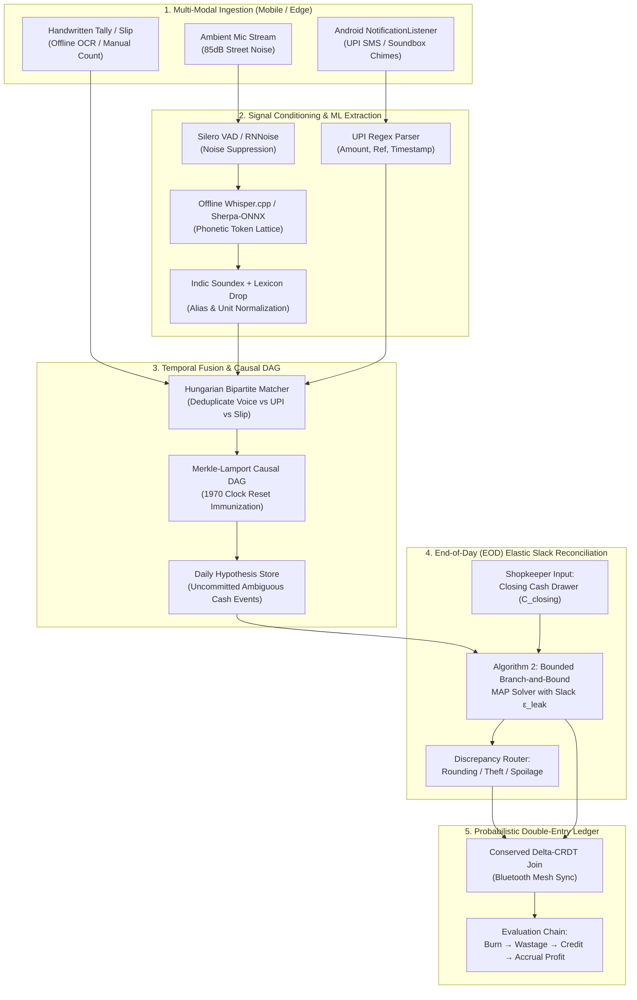

# FEATURES TO IMPLEMENT: PHASED EXECUTION ROADMAP
**Project:** Team Cascade — The Invisible Worker  
**Architecture:** 0.5% Anti-Template Probabilistic Offline Ledger Engine  
**Objective:** Chronological, dependency-ordered blueprint detailing what must be built first, second, and later.

---

## 1. System Overview & The 0.5% Core Differentiator

Most hackathon teams build a generic cloud chatbot or CRUD app with a prompt wrapper that fails under 85dB street noise, assumes reliable 4G, crashes when phone clocks reset to 1970, and accepts hallucinated point guesses.

**Team Cascade's Approach:**
A **100% offline, on-device probabilistic double-entry ledger** that:
1. Reconstructs balance sheets from noisy multi-channel inputs (ambient audio, delayed UPI SMS chimes, handwritten slips).
2. Derives dynamic recipe bills of materials (BOM) purely from raw material burn rates via Non-Negative Matrix Factorization (NMF).
3. Attributes unrecorded inventory loss into spoilage, theft, and personal consumption via Arrhenius thermal decay and Bayesian mixtures.
4. Survives dead batteries and 1970 epoch clock resets using a Merkle-Lamport Causal DAG and Conserved Double-Entry Delta-CRDTs.
5. Employs **Algorithm 2 (Elastic Slack MAP Reconciliation)** at End-of-Day (EOD): using the shopkeeper’s physical cash count to mathematically disambiguate the entire day's audio conversation log without crashing over loose change or dropped coins.

---

## 2. End-to-End Technical Workflow



---

## 3. Mobile Notification & Voice Recognition ML Interfacing

A critical engineering bottleneck in street vendor setups is how to interface Android system notifications (UPI) and raw microphone audio with the ML pipeline completely offline on low-end hardware.

### A. Ambient Audio Pipeline (85dB Noisy Street Audio $\to$ ML)

1. **Audio Capture Layer (`mobile/src/services/AudioCaptureService.ts`):**
   - Uses React Native Audio / native Android `AudioRecord` streaming 16kHz mono 16-bit PCM.
   - Ring buffer chunks audio into 3-second overlapping sliding windows.

2. **Edge Noise Suppression & Voice Activity Detection (VAD):**
   - **Silero VAD / WebRTC VAD:** Detects speech probability. Discards pure ambient traffic rumble (<0.3 speech energy).
   - **RNNoise (WASM / C++ compiled):** Suppresses background truck horns, blender, and engine noise without cloud latency.

3. **Offline Automatic Speech Recognition (ASR):**
   - Runs `whisper.cpp` (quantized `tiny-q5_1`, ~75MB RAM) or `Sherpa-ONNX` (offline Indic model).
   - **Output Format:** Rather than a single greedy string, it produces a **Confidence Hypothesis Graph**:
     ```json
     {
       "snippetId": "aud-1049",
       "timestamp": 1729841200000,
       "rawTranscript": "Sharma ji ka 40 jama kar aur 7 plate poha de",
       "entities": [
         { "type": "ALIAS", "raw": "Sharma ji", "canonicalId": "ENT-SHARMA-01", "confidence": 0.92 },
         { "type": "CREDIT_PAYMENT", "amount": 40, "confidence": 0.88 },
         { "type": "ORDER", "item": "poha", "quantity": 7, "unit": "plate", "confidence": 0.95 }
       ]
     }
     ```
   - When noise makes the amount ambiguous (*"bhai 20 diya ya 30?"*), it outputs candidate hypotheses:
     `candidateAmounts: [{ amount: 20, confidence: 0.65 }, { amount: 30, confidence: 0.35 }]`.

### B. Mobile Notification Listener Pipeline (UPI SMS & Soundbox Chimes $\to$ ML)

1. **Android `NotificationListenerService`:**
   - Listens to system-level status bar notifications from payment apps: PhonePe Business, Paytm for Business, Google Pay for Business, BHIM, and bank SMS channels (SBI, HDFC, PNB).
2. **Regex & Semantic Extraction:**
   - Extracts:
     - `amount`: Clean numeric float (e.g., `40.00`).
     - `payer`: Extracted if available (e.g., `R Sharma`).
     - `refId`: UPI Transaction Ref / RRN to enforce **strict idempotency** (zero duplicate accounting).
     - `timestamp`: Event arrival time.
3. **Payload Structure:**
   ```json
   {
     "id": "upi-992144",
     "source": "PAYTM_SOUNDBOX_NOTIFICATION",
     "amount": 40.0,
     "currency": "INR",
     "refId": "UPI429019284102",
     "timestamp": 1729841215000
   }
   ```

### C. Cross-Modal Temporal Fusion & Deduplication (The Bridge)

To avoid double-counting when a vendor says *"Sharma ji ka 40 jama kar"* and 15 seconds later a Soundbox chimes *"Paytm par 40 rupaye prapt hue"*:

1. **Temporal Horizon Buffer:**
   - Both events enter an in-memory sliding window buffer ($\Delta t = \pm 180\text{ seconds}$).
2. **Kuhn-Munkres (Hungarian) Bipartite Matching:**
   - Computes bipartite affinity cost between pending audio credit events and incoming UPI notifications:
     $$C(i, j) = w_{\text{amount}} \cdot |A_{\text{audio}} - A_{\text{upi}}| + w_{\text{time}} \cdot \frac{|t_1 - t_2|}{180} + w_{\text{alias}} \cdot (1 - \text{Sim}(\text{Entity}, \text{Payer}))$$
3. **Fusion Decision:**
   - If cost $C(i, j) < \text{threshold}$, the two events **collapse into a single reconciled transaction**:
     - `DR Assets:Bank:UPI ₹40` / `CR Assets:Receivable:Sharma ₹40`.
     - The physical cash drawer balance is **not** touched.
   - If no UPI match arrives, the audio transaction is flagged as **Pending Cash / Unconfirmed**, queued for End-of-Day reconciliation.

---

## 4. Phased Implementation Roadmap (Strict Dependency Order)

To ensure rapid, non-blocking execution, features are organized into sequential phases. Each phase builds directly on the mathematical and architectural outputs of previous phases.

```
PHASE 1: Core Invariants & Hostile Clock CRDT
   │ (Establish infallible causal ordering & double-entry balance)
   ▼
PHASE 2: Mobile Ingestion & Edge ML Perception
   │ (Capture 85dB speech, VAD, and background UPI notifications)
   ▼
PHASE 3: Cross-Modal Fusion & Daily Hypothesis Store
   │ (Hungarian bipartite matching, deduplication & causal buffering)
   ▼
PHASE 4: End-of-Day (EOD) Elastic Slack Reconciliation (Algorithm 2)
   │ (Disambiguate the day's audio log via physical cash drawer count)
   ▼
PHASE 5: Probabilistic Evaluation Chain & Accrual Engine
   │ (Online-NMF recipe burn, Arrhenius loss attribution & interval profit)
   ▼
PHASE 6: 3-Run Sabotage Benchmark & Demo Hardening
     (Side-by-side judge demonstration against hostile edge cases)
```

---

### PHASE 1: Core Invariants, Hostile Clocks & Conserved CRDT
> **Priority:** CRITICAL (Must be built FIRST)  
> **Rationale:** All downstream accounting, speech processing, and persistence depend on having immutable causal ordering and strict double-entry balance guarantees.

#### 1.1 Shared Data Contracts & Mathematical Bounds
* **Target File:** `shared/types.ts`
* **Deliverables:**
  - Define `EpistemicConfidence` lattice: `VERIFIED_KNOWN`, `PROBABLE`, `DEGRADED_OUTDATED`, `UNKNOWN_ABSTAIN`.
  - Define `AffineInterval` structures (`minEstimate`, `maxEstimate`, `uncertaintyInterval`).
  - Define multi-modal payload types (`AudioHypothesis`, `UPINotification`, `CRDTOperation`, `EODReconciliationRequest`).

#### 1.2 Merkle-Lamport Causal DAG (1970 Epoch Clock Invariant)
* **Target File:** `core/crdt/causal_dag.ts`, `core/constraints.ts`
* **Deliverables:**
  - **Quarantine Wall-Clock Timestamps:** Detect timestamps $< 172800000$ ms (the 1970 UNIX epoch reset caused by dead phone batteries) or future time-travel jumps.
  - **Topological Causal Ordering:** Order events strictly by Lamport logical clocks + cryptographic parent hashes ($H = \text{SHA256}(\text{ParentHashes} \parallel \text{Payload})$).
  - Guarantee that no battery depletion event can reorder, overwrite, or invalidate historic ledger transactions.

#### 1.3 Conserved Double-Entry Delta-CRDT
* **Target File:** `core/crdt/double_entry_crdt.ts`
* **Deliverables:**
  - Model every transaction as an atomic balanced delta 2-tuple:
    $$\Delta T = \langle \text{TxID}, \text{DebitAccount}, \text{CreditAccount}, [\text{val}_{\min}, \text{val}_{\max}], \text{LamportClock}, \text{NodeID} \rangle$$
    $$\text{Invariant: } \Delta \text{Balance}(\text{Debit}) + \Delta \text{Balance}(\text{Credit}) \equiv 0$$
  - Implement commutative, associative lattice joins ($S_A \cup S_B$) allowing 3 family phones to sync over offline Bluetooth mesh bursts without merge conflicts or zero-sum violations.

---

### PHASE 2: Mobile Ingestion & Edge ML Perception Pipeline
> **Priority:** HIGH (Prerequisite: Phase 1)  
> **Rationale:** We need reliable multi-channel sensory inputs (speech and notifications) conditioned and pre-processed before feeding the causal ledger.

#### 2.1 Android Notification & SMS Listener Bridge
* **Target File:** `mobile/services/NotificationListener.ts`
* **Deliverables:**
  - Android `NotificationListenerService` hook capturing status-bar alerts from Paytm, PhonePe, Google Pay, BHIM, and bank SMS channels.
  - Regex parser extracting amount, payer identifier, timestamp, and RRN transaction reference.
  - Strict deduplication hash generation to prevent duplicate accounting.

#### 2.2 Offline Noise Suppression & Voice Activity Detection (VAD)
* **Target File:** `mobile/services/AudioCaptureService.ts`, Python microservice DSP module
* **Deliverables:**
  - 16kHz PCM streaming capture via mobile microphone.
  - **RNNoise Filter:** Strip 85dB heavy traffic horns and background diesel engine noise, preserving 300Hz–3400Hz speech formants.
  - **Silero VAD / WebRTC VAD:** Detect speech boundaries and discard non-speech traffic segments (<0.3 energy).

#### 2.3 Offline ASR & Ambiguous Hypothesis Generator
* **Target File:** `core/linguistics/indic_phonetic.ts`, Python microservice (`localhost:8000`)
* **Deliverables:**
  - Lightweight quantized `whisper.cpp` (`tiny-q5_1`) / Sherpa-ONNX model.
  - Generates token confidence lattices instead of fragile point strings.
  - Emits ambiguous candidates for masked numbers: e.g., `candidateAmounts: [{ amount: 20, confidence: 0.65 }, { amount: 30, confidence: 0.35 }]`.
  - **Indic Phonetic Soundex & Trie:** Normalizes hyper-local customer aliases (*"Sharma ji"*, *"Sarmaji"*, *"Pandit ji"*) in $<1\text{ms}$.

#### 2.4 Dynamic Unit Normalizer (Bayesian Conjugate Calibrator)
* **Target File:** `core/linguistics/dynamic_units.ts`
* **Deliverables:**
  - Models fluctuating, non-standard colloquial units (*"katori"*, *"mutthi"*, *"pav"*, *"gaddi"*) as Gaussian distributions $W_u \sim \mathcal{N}(\mu_u, 1/\tau_u)$.
  - Analytical Bayesian update calibrates gram weights on-device when wholesale bulk purchases arrive.

---

### PHASE 3: Cross-Modal Fusion & The Daily Hypothesis Buffer
> **Priority:** HIGH (Prerequisite: Phases 1 & 2)  
> **Rationale:** Connects raw multi-modal sensory inputs to the causal ledger, preventing duplicate entries between spoken declarations and delayed digital payment chimes.

#### 3.1 Kuhn-Munkres (Hungarian) Bipartite Matcher
* **Target File:** `core/fusion/bipartite_matcher.ts`
* **Deliverables:**
  - Temporal horizon buffer with $\pm 180\text{-second}$ sliding window.
  - Solves the bipartite matching problem between candidate speech declarations and delayed UPI payment chimes.
  - Collapses matched pairs into single verified digital transactions (`DR Assets:Bank:UPI` / `CR Revenue:Sales`), ensuring zero duplicate entries.

#### 3.2 Daily Causal Hypothesis Store
* **Target File:** `core/reconciliation/conversation_log.ts`, `server/src/db/storage.ts`
* **Deliverables:**
  - Append-only SQLite WAL persistence layer.
  - Distinguishes between:
    1. **Committed Verified Transactions:** Confirmed UPI payments, verified wholesale receipts.
    2. **Uncommitted Ambiguous Cash Hypotheses:** Audio events tagged with multiple candidate amount interpretations awaiting end-of-day resolution.

---

### PHASE 4: End-of-Day (EOD) Elastic Slack Reconciliation (Algorithm 2)
> **Priority:** HIGH (Prerequisite: Phase 3)  
> **Rationale:** Real street food stalls operate with loose coins, rounding friction, and unrecorded chai expenses. Algorithm 2 uses the vendor's physical cash count to mathematically resolve the day's ambiguous audio log without crashing.

#### 4.1 Bounded Branch-and-Bound MAP Solver with Elastic Slack
* **Target File:** `core/reconciliation/eod_cash_settler.ts`
* **Deliverables:**
  - Computes net target sales cash:
    $$\Delta C_{\text{target}} = C_{\text{closing}} - C_{\text{opening}} + E_{\text{cash}}$$
  - Implements Maximum A Posteriori (MAP) solver:
    $$\min_{\mathbf{z}} \sum_{i=1}^N \left( -\log P(\text{Audio}_i \mid a_{i, \text{chosen}}) \right) + \lambda \cdot |\epsilon_{\text{slack}}| \quad \text{s.t.} \quad \sum_{i=1}^N a_{i, \text{chosen}} + \epsilon_{\text{slack}} = \Delta C_{\text{target}}$$
  - Heuristic $A^*$ search exploring hypothesis branches in descending order of acoustic confidence in $<10\text{ms}$.

#### 4.2 Discrepancy Attribution Router
* **Target File:** `core/reconciliation/eod_cash_settler.ts`
* **Deliverables:**
  - Route the residual slack $\epsilon_{\text{slack}}$:
    - $|\epsilon_{\text{slack}}| \le ₹15 \implies$ **Coin Rounding & "Chutta" Friction**.
    - $\epsilon_{\text{slack}} < -₹15 \implies$ **Theft / Unrecorded Personal Consumption**.
    - $\epsilon_{\text{slack}} > +₹15 \implies$ **Unrecorded Cash Sales Drowned by Traffic Horns**.
  - Commit disambiguated events to the double-entry CRDT ledger.

#### 4.3 Mobile EOD Drawer Modal UI
* **Target File:** `mobile/components/EODReconciliationModal.tsx`
* **Deliverables:**
  - Intuitive 10-second end-of-day input dialog for the shopkeeper ($C_{\text{opening}}$, $C_{\text{closing}}$, $E_{\text{cash}}$).
  - Displays instant reconciliation breakdown: matched events, confidence scores, and explained discrepancy margin.

---

### PHASE 5: Probabilistic Evaluation Chain & Accrual Engine
> **Priority:** MEDIUM-HIGH (Prerequisite: Phases 1, 3 & 4)  
> **Rationale:** Derives true business health (COGS, recipe portions, spoilage vs theft, and true accrual profit) from the reconciled ledger without requiring a manual Bill of Materials.

#### 5.1 Zero-Shot Recipe Inference & Dynamic Portion Tracking (No BOM)
* **Target File:** `core/probabilistic/recipe_inference.ts`
* **Deliverables:**
  - **Online Non-Negative Matrix Factorization (NMF):** Deduces latent ingredient consumption matrix $\mathbf{A} \ge 0$ from bulk purchase burn $\mathbf{B}$ and plate sales $\mathbf{S}$ ($\mathbf{B} \approx \mathbf{A} \mathbf{S}$).
  - **Extended Kalman Filter (EKF):** Tracks continuous portion drift (e.g., tomato grams per plate shrinking as tomato market prices surge).

#### 5.2 Environmental Covariate Loss Attribution
* **Target File:** `core/probabilistic/loss_attribution.ts`
* **Deliverables:**
  - **Arrhenius Kinetic Perishability Model:** Calculates perishable inventory decay rate $k_{\text{decay}}(T, H)$ as an exponential function of ambient temperature ($T$) and humidity ($H$).
  - **Dirichlet-Multinomial Conjugate Mixture:** Decomposes unrecorded inventory shrinkage into probability distributions for **Spoilage**, **Theft**, and **Family Consumption**.

#### 5.3 True Accrual Profit & Affine Interval Engine
* **Target File:** `core/probabilistic/affine_intervals.ts`, `core/engine.ts`
* **Deliverables:**
  - Computes bounded True Accrual Profit:
    $$\text{Accrual Profit} = [\text{Cash Revenue} + \Delta \text{Receivables}_{\text{reconciled}}] - [\text{COGS}_{\text{burned}} + \text{Wastage}_{\text{attributed}} + \text{Operational Expense}]$$
  - Propagates correlations using Affine Arithmetic to prevent exponential interval explosion, outputting $[\text{Min}, \text{Expected}, \text{Max}]$ profit bounds.

---

### PHASE 6: 3-Run Sabotage Benchmark & Demo Hardening
> **Priority:** FINAL (Prerequisite: All previous phases)  
> **Rationale:** The 0.5% winning hackathon strategy requires proving superior reliability under hostile conditions via a live, reproducible 3-run side-by-side demonstration.

#### 6.1 Adversarial Dataset Expansion
* **Target File:** `evaluation/datasets/adversarial_cases.json`
* **Deliverables:**
  - Case 1: `CLOCK_DRIFT_1970` (dead battery reset to 1970-01-01).
  - Case 2: `NOISE_85DB` (acoustic sentence drowned by truck horn).
  - Case 3: `DELAYED_UPI_CROSS_MODAL` (voice order followed by 18-minute delayed UPI notification).
  - Case 4: `CAUSAL_INVERSION_MESH` (out-of-order Bluetooth mesh sync).

#### 6.2 Automated Benchmark Runner & Metrics
* **Target File:** `evaluation/benchmark.ts`, `evaluation/metrics.ts`
* **Deliverables:**
  - Execute automated 3-Run benchmark:
    - *Run 1:* Standard baseline succeeds on clean inputs.
    - *Run 2:* Hostile sabotage injected $\to$ Competitor Baseline crashes or hallucinates with false confidence.
    - *Run 3:* Cascade Core Engine catches invariants, abstains safely or recovers bounded intervals.
  - Output quantitative metrics: Baseline Crash Rate (%), Engine Recovery Rate (%), and Latency Ratio ($<50\text{ms}$).

#### 6.3 Mobile & Dashboard Integration
* **Target File:** `mobile/App.tsx`, `server/src/index.ts`
* **Deliverables:**
  - Live WebSocket synchronization between mobile app and server.
  - Interactive judge sabotage sliders (Noise dB, Clock Drift, Mesh Severance).
  - Visual display of epistemic tags, bounds, and reconciled double-entry journal entries.

---

## 5. Phase Dependency & Deliverable Matrix

| Phase | Phase Name | Direct Prerequisites | Primary Output Files |
| :---: | :--- | :--- | :--- |
| **1** | **Core Invariants & Hostile Clock CRDT** | None (Foundational) | `shared/types.ts`<br>`core/constraints.ts`<br>`core/crdt/causal_dag.ts`<br>`core/crdt/double_entry_crdt.ts` |
| **2** | **Mobile Ingestion & Edge ML Perception** | Phase 1 | `mobile/services/NotificationListener.ts`<br>`mobile/services/AudioCaptureService.ts`<br>`core/linguistics/indic_phonetic.ts`<br>`core/linguistics/dynamic_units.ts` |
| **3** | **Cross-Modal Fusion & Hypothesis Store** | Phase 1, Phase 2 | `core/fusion/bipartite_matcher.ts`<br>`core/reconciliation/conversation_log.ts`<br>`server/src/db/storage.ts` |
| **4** | **EOD Elastic Slack Reconciliation (Alg 2)** | Phase 3 | `core/reconciliation/eod_cash_settler.ts`<br>`mobile/components/EODReconciliationModal.tsx` |
| **5** | **Probabilistic Evaluation Chain** | Phase 1, Phase 3, Phase 4 | `core/probabilistic/recipe_inference.ts`<br>`core/probabilistic/loss_attribution.ts`<br>`core/probabilistic/affine_intervals.ts`<br>`core/engine.ts` |
| **6** | **3-Run Sabotage Benchmark & Demo** | Phase 1 through Phase 5 | `evaluation/benchmark.ts`<br>`evaluation/datasets/adversarial_cases.json`<br>`mobile/App.tsx`<br>`server/src/index.ts` |
